[English](README.md) · [العربية](README.ar.md) · [简体中文](README.zh-CN.md) · [繁體中文](README.zh-TW.md) · [Čeština](README.cs.md) · [Français](README.fr.md) · **Deutsch** · [Ελληνικά](README.el.md) · [Bahasa Indonesia](README.id.md) · [Gaeilge](README.ga.md) · [Italiano](README.it.md) · [日本語](README.ja.md) · [한국어](README.ko.md) · [Polski](README.pl.md) · [Română](README.ro.md) · [Русский](README.ru.md) · [Español](README.es.md) · [Українська](README.uk.md) · [اردو](README.ur.md) · [ئۇيغۇرچە](README.ug.md) · [Tiếng Việt](README.vi.md)

<div align="center">


<br>



<a href="https://github.com/sailxx/Ember/releases/latest/download/Ember.apk"></a>&nbsp; &nbsp;<a href="https://github.com/sailxx/Ember/releases/latest"></a>

**Ember ist ein Blaulichtfilter für Android.** Abends wird der Bildschirm warm, morgens ist er wieder normal. Der Ember berechnet Sonnenauf- und -untergänge selbstständig, ohne Internet und ohne Werbung.

</div>

<br>


<details>
<summary><b>Mehr zu den Funktionen</b></summary>

### 🔥 Filter

Eine warme, durchscheinende Schicht bedeckt den gesamten Bildschirm. **Stärke** legt fest, wie dicht es ist, **Dimmen** Macht den Bildschirm dunkler (praktisch bei Nacht statt minimaler Helligkeit). Die Ebene wird von einem Barrierefreiheitsdienst erstellt: Das System behandelt sein Fenster als vertrauenswürdig, sodass Berührungen den Filter überall passieren, auch auf geschützten Bildschirmen. Ember liest nie den Bildschirm. Ohne den Dienst fällt der Filter auf „Anzeige über anderen Apps“ zurück, wobei Android 12+ die Deckkraft begrenzt und Berührungen auf einigen Bildschirmen blockiert.

### 🌅 Zeitplan

Drei Modi: **Bei der Sonne** — Tippen Sie auf „Orten“ neben „Ort“. Ember liest Ihre Koordinaten einmal und berechnet den Sonnenuntergang und Sonnenaufgang für jeden Tag (NOAA-Algorithmus, direkt auf dem Telefon).; **Mit der Zeit** — Ihre eigenen Ein- und Ausschaltzeiten; **Stets** — Der Filter bleibt aktiviert, solange er aktiviert ist. Bis ein Ort festgelegt ist, verwendet „Bei der Sonne“ Ihre eigenen Zeiten (standardmäßig 21:00–07:00 Uhr). Die Überblendung dauert 0, 15, 30 oder 60 Minuten. Das Diagramm auf dem Hauptbildschirm zeigt, wann und wie stark der Filter den Bildschirm erwärmt.

### 🎛 Kachel und Benachrichtigung

Die Ember-Kachel in den Schnelleinstellungen schaltet den Filter mit einem Fingertipp ein und aus. Die Benachrichtigung zeigt an, was gerade passiert („2700 K · bis 06:48“ oder „Warten auf Sonnenuntergang“) und verfügt über eine Schaltfläche „Ausschalten“. Nach einem Neustart kommt der Filter von selbst wieder zurück.

### 🔒 Privatsphäre

Ember hat **kein Internetzugang** — Die Berechtigung ist nicht im Manifest enthalten. Koordinaten werden nur in den Einstellungen der App gespeichert.

</details>

<br>


<br>


## Über Ember


Ember begann am **16. Oktober 2026** als kleines Projekt, um Android-Bildschirme nachts wärmer zu machen. Es ist kostenlos und nicht kommerziell. Es gibt keine Werbung, Konten oder Analysen. Ember verfolgt Sie nicht, sammelt Ihre Daten nicht und wird dies auch niemals tun.

Ihre Einstellungen bleiben auf Ihrem Telefon. Wenn Sie Ihren Standort für den Zeitplan verwenden möchten, liest der Ember diesen einmal und berechnet Sonnenauf- und -untergang auf dem Gerät. Die App verfügt über keine Internetberechtigung. [Datenschutzrichtlinie](PRIVACY.md)

## Roadmap


- [**0.1**](https://github.com/sailxx/Ember/releases/tag/v0.1) — Die erste Version erwärmte den Bildschirm, verfolgte Sonnenuntergang und Sonnenaufgang und zeigte den ganzen Tag auf einer Karte an.
- [**0.2**](https://github.com/sailxx/Ember/releases/tag/v0.2) — Der Barrierefreiheitsdienst lässt Taps durch den Filter passieren.
- [**0.3**](https://github.com/sailxx/Ember/releases/tag/v0.3) — Benutzerdefinierte Ein- und Ausschaltzeiten hinzugefügt und es Ember einfacher gemacht, Ihren Standort zu finden.
- [**0.4**](https://github.com/sailxx/Ember/releases/tag/v0.4) — Das Tagesdiagramm wurde neu gestaltet und ein klareres Feedback hinzugefügt, wenn Sie auf ein Steuerelement tippen.
- [**0.5**](https://github.com/sailxx/Ember/releases/tag/v0.5) — Von einem Debug-Schlüssel auf den eigenen Schlüssel von Ember zum Signieren von Veröffentlichungen umgestellt.
- [**0.6**](https://github.com/sailxx/Ember/releases/tag/v0.6) — Ein Temperaturregler, eine Auswahl an hellen oder dunklen Themen und Tests für den Tagesplan wurden hinzugefügt.
- [**0.7**](https://github.com/sailxx/Ember/releases/tag/v0.7) — Temperatur- und Filtersteuerung auf einem Bildschirm zusammengefasst, Zeitplan in einen Dialog verschoben und ein schwebender Schalter hinzugefügt.
- [**0.8**](https://github.com/sailxx/Ember/releases/tag/v0.8) — In den Einstellungen wurde Englisch mit Russisch als Standard festgelegt, das Symbol mit dem weißen Kreis hinzugefügt und der Barrierefreiheitsdienst konnte den Filter selbst anwenden.
- [**1.0**](https://github.com/sailxx/Ember/releases/tag/v1.0) — Die Temperaturkarte wurde vereinfacht und der Schieberegler geglättet. Die Farbe der Karte und der Filterschaltfläche ändert sich jetzt beim Ziehen gemeinsam.

<details>
<summary><b>Installieren</b></summary>

1. Herunterladen [`Ember.apk`](https://github.com/sailxx/Ember/releases/latest/download/Ember.apk).
2. Öffnen Sie es auf Ihrem Telefon und erlauben Sie die Installation aus unbekannten Quellen.
3. Öffnen Sie Ember und tippen Sie auf **Filter einschalten**, dann wählen **Zugriff einrichten → Barrierefreiheit** und aktivieren Sie Ember .
   Öffnen Sie auf Android 13+ für Apps, die außerhalb von Play installiert sind, zunächst App-Info → ⋮ → „Eingeschränkte Einstellungen zulassen“.
4. Android 8.0 oder neuer.

</details>

<details>
<summary><b>Entwicklung</b></summary>

Kotlin 2.2 + Jetpack Compose (Material 3), keine Abhängigkeiten von Drittanbietern.

```bash
./gradlew assembleRelease     # APK in app/build/outputs/apk/release/
./gradlew testDebugUnitTest   # sunset, sunrise and the filter curve
./gradlew lintDebug           # Android Lint checks
```

Erfordert JDK 17+ und Android SDK (Plattform 35). README-Bilder werden generiert – bearbeiten `tools/readme/strings.json` und laufen `cd tools/readme && npm install && node build.mjs`.

Überprüfen Sie vor der Veröffentlichung diese Schritte auf einem Gerät im Immermodus:

1. Tippen Sie auf die Kachel „Schnelleinstellungen“, während beide Overlay-Berechtigungen deaktiviert sind. Gewähren Sie eines davon und kehren Sie zu Ember zurück. Der Filter sollte erscheinen, ohne dass Sie erneut auf die Kachel tippen müssen.
2. Schalten Sie den Filter in den Schnelleinstellungen um und deaktivieren Sie ihn dann in der Benachrichtigung. Ember und die Kachel sollten übereinstimmen. Wenn Sie die Stärke ändern, sollte der Filter ausgeschaltet bleiben.
3. Starten Sie mit aktiviertem Filter neu. Nach dem Entriegeln sollte der Filter zurückkehren. Wiederholen Sie dies separat mit dem Eingabehilfedienst und der Berechtigung zur Anzeige über anderen Apps.

</details>
