<div align="center">

[Русский](README.md) · **English**

<br>



<a href="https://github.com/sailxx/Ember/releases/latest/download/Ember.apk"></a>&nbsp;&nbsp;<a href="https://github.com/sailxx/Ember/releases/latest"></a>

**Ember is a blue light filter for Android.** In the evening the screen turns warm, in the morning it goes back to normal. Ember works out sunset and sunrise on its own, with no internet and no ads.

</div>

<br>



<details>
<summary><b>More about the features</b></summary>

### 🔥 Filter

A warm translucent layer covers the whole screen. **Strength** sets how dense it is, **dimming** makes the screen darker (handy at night instead of minimum brightness). The layer is drawn by an accessibility service: the system treats its window as trusted, so touches pass through the filter everywhere, even on protected screens. Ember never reads the screen. Without the service the filter falls back to “Display over other apps”, where Android 12+ limits opacity and blocks taps on some screens.

### 🌅 Sun-based schedule

Tap “Default” and allow location — Ember reads your coordinates once and calculates sunset and sunrise for every day (NOAA algorithm, right on the phone). Without a location the filter runs from 21:00 to 07:00. The fade lasts 0, 15, 30 or 60 minutes. The chart on the main screen shows when and how strongly the filter warms the screen.

### 🎛 Tile and notification

The Ember tile in Quick Settings turns the filter on and off with one tap. The notification shows what’s happening (“2700 K · until 06:48” or “Waiting for sunset”) and has a “Turn off” button. After a reboot the filter comes back on its own.

### 🔒 Privacy

Ember has **no internet access** — the permission isn’t in the manifest. Coordinates are stored only in the app’s settings.

</details>

<br>



<br>



<details>
<summary><b>Install</b></summary>

1. Download [`Ember.apk`](https://github.com/sailxx/Ember/releases/latest/download/Ember.apk).
2. Open it on your phone and allow installing from unknown sources.
3. Launch Ember, tap the orange card and enable Ember in Accessibility — then touches always pass through the filter.
   On Android 13+ for apps installed outside Play, first open App info → ⋮ → “Allow restricted settings”.
4. Android 8.0 or newer.

</details>

<details>
<summary><b>Development</b></summary>

Kotlin 2.2 + Jetpack Compose (Material 3), no third-party dependencies.

```bash
./gradlew assembleRelease     # APK in app/build/outputs/apk/release/
./gradlew testDebugUnitTest   # sunset, sunrise and the filter curve
```

Requires JDK 17+ and Android SDK (platform 35). README images are generated — edit `tools/readme/strings.json` and run `cd tools/readme && npm install && node build.mjs`.

</details>
