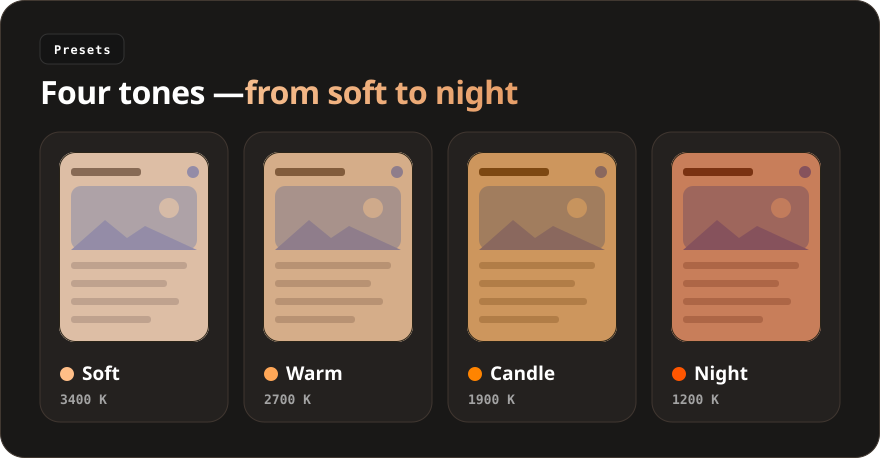

[English](README.md) · [العربية](README.ar.md) · [简体中文](README.zh-CN.md) · [繁體中文](README.zh-TW.md) · [Čeština](README.cs.md) · [Français](README.fr.md) · [Deutsch](README.de.md) · [Ελληνικά](README.el.md) · [Bahasa Indonesia](README.id.md) · **Gaeilge** · [Italiano](README.it.md) · [日本語](README.ja.md) · [한국어](README.ko.md) · [Polski](README.pl.md) · [Română](README.ro.md) · [Русский](README.ru.md) · [Español](README.es.md) · [Українська](README.uk.md) · [اردو](README.ur.md) · [ئۇيغۇرچە](README.ug.md) · [Tiếng Việt](README.vi.md)

<div align="center">


<br>


<a href="https://github.com/sailxx/Ember/releases/latest/download/Ember.apk"></a>&nbsp; &nbsp;<a href="https://github.com/sailxx/Ember/releases/latest"></a>

**Is scagaire solais gorm é Ember le haghaidh Android .** Sa tráthnóna casann an scáileán te, ar maidin téann sé ar ais go gnáth. Oibríonn Ember luí na gréine agus éirí na gréine leis féin, gan aon idirlíon agus gan fógraí.

</div>

<br>


<details>
<summary><b>Tuilleadh faoi na gnéithe</b></summary>

### 🔥 Scagaire

Clúdaíonn ciseal tréshoilseach te an scáileán iomlán. **Neart** leagann sé chomh dlúth agus atá sé, **maolú** a dhéanann an scáileán níos dorcha (áisiúil san oíche in ionad gile íosta). Tá an ciseal tarraingthe ag seirbhís inrochtaineachta: déileálann an córas lena fhuinneog mar iontaofa, mar sin téann tadhaill tríd an scagaire i ngach áit, fiú ar scáileáin chosanta. Ní léann Ember an scáileán riamh. Gan an tseirbhís titeann an scagaire ar ais go dtí “Taispeáin thar aipeanna eile”, áit a gcuireann Android 12+ teorainn le teimhneacht agus blocálann sé sconnaí ar scáileáin áirithe.

### 🌅 Sceideal

Trí mhodh: **Faoin ghrian** — tapáil “Aimsigh” in aice le “Áit”, léann Ember do chomhordanáidí uair amháin agus ríomhann sé luí na gréine agus éirí na gréine gach lá (algartam NOAA, díreach ar an bhfón); **De réir ama** — do chuid féin ar agus as uaireanta; **I gcónaí** — fanann an scagaire ar siúl agus é cumasaithe. Go dtí go leagtar áit, úsáideann “Faoi na gréine” do chuid ama féin (21:00-07:00 de réir réamhshocraithe). Maireann an céimnithe 0, 15, 30 nó 60 nóiméad. Taispeánann an chairt ar an bpríomhscáileán cathain agus cé chomh láidir is a théann an scagaire an scáileán.

### 🎛 Tíleanna agus fógra

Casann an tíl Ember i Socruithe Tapa an scagaire air agus as le sconna amháin. Léiríonn an fógra cad atá ag tarlú (“2700 K · go dtí 06:48” nó “Ag feitheamh le luí na gréine”) agus tá cnaipe “Múch as”. Tar éis atosaigh tagann an scagaire ar ais leis féin.

### 🔒 Príobháideacht

Tá Ember **gan rochtain idirlín** — níl an cead sa léiriú. Ní stóráiltear comhordanáidí ach i socruithe na haipe.

</details>

<br>



<br>


## Maidir Ember


Thosaigh Ember ar **16 Deireadh Fómhair, 2026** mar thionscadal beag chun scáileáin Android a dhéanamh níos teo san oíche. Tá sé saor in aisce agus neamhthráchtála. Níl aon fhógraí, cuntais ná anailísíocht ann. Ní rianaíonn Ember tú, ní bhailíonn sé do shonraí, agus ní dhéanfaidh sé.

Fanann do shocruithe ar do ghuthán. Má roghnaíonn tú do shuíomh a úsáid don sceideal, léann Ember é uair amháin agus oibríonn sé amach éirí agus luí na gréine ar an ngléas. Níl aon chead idirlín ag an aip. [Beartas príobháideachta](PRIVACY.md)

## Treochlár


- [**0.1**](https://github.com/sailxx/Ember/releases/tag/v0.1) — Rinne an chéad leagan an scáileán a théamh, tar éis luí na gréine agus éirí na gréine, agus léirigh sé an lá iomlán ar chairt.
- [**0.2**](https://github.com/sailxx/Ember/releases/tag/v0.2) — Ligeann an tseirbhís inrochtaineachta do sconnaí dul tríd an scagaire.
- [**0.3**](https://github.com/sailxx/Ember/releases/tag/v0.3) — Cuireadh amanna saincheaptha ar siúl agus as agus rinne sé níos éasca do Ember do shuíomh a aimsiú.
- [**0.4**](https://github.com/sailxx/Ember/releases/tag/v0.4) — Athdhearadh an chairt laethúil agus cuireadh aiseolas níos soiléire leis nuair a thapálann tú rialtán.
- [**0.5**](https://github.com/sailxx/Ember/releases/tag/v0.5) — Aistrithe ó eochair dífhabhtaithe go dtí eochair Ember féin chun eisiúintí a shíniú.
- [**0.6**](https://github.com/sailxx/Ember/releases/tag/v0.6) — Cuireadh dhiailiú teochta leis, rogha de théama éadrom nó dorcha, agus tástálacha don sceideal laethúil.
- [**0.7**](https://github.com/sailxx/Ember/releases/tag/v0.7) — Tugadh rialuithe teochta agus scagaire isteach ar scáileán amháin, bhog an sceideal isteach i dialóg, agus chuir lasc ar snámh leis.
- [**0.8**](https://github.com/sailxx/Ember/releases/tag/v0.8) — Rinne an Béarla an réamhshocrú le Rúisis i Socruithe, chuir sé an deilbhín bán-chiorcail leis, agus lig don tseirbhís inrochtaineachta an scagaire a chur i bhfeidhm ina haonar.
- [**1.0**](https://github.com/sailxx/Ember/releases/tag/v1.0) — Simpligh an cárta teochta agus smoothed an sleamhnán. Athraíonn an cnaipe cárta agus scagaire dath le chéile anois agus tú ag tarraingt.

<details>
<summary><b>Suiteáil</b></summary>

1. Íosluchtaigh [`Ember.apk`](https://github.com/sailxx/Ember/releases/latest/download/Ember.apk).
2. Oscail é ar do ghuthán agus cead a shuiteáil ó fhoinsí anaithnid.
3. Oscail Ember , sconna **Cuir an scagaire ar siúl**, roghnaigh ansin **Socraigh rochtain → Inrochtaineacht** agus cumasaigh Ember .
   Ar Android 13+ le haghaidh apps atá suiteáilte lasmuigh de Play, oscail faisnéis App ar dtús → ⋮ → “Ceadaigh socruithe srianta”.
4. Android 8.0 nó níos nuaí.

</details>

<details>
<summary><b>Forbairt</b></summary>

Kotlin 2.2 + Jetpack Compose (Ábhar 3), gan aon spleáchais tríú páirtí.

```bash
./gradlew assembleRelease     # APK in app/build/outputs/apk/release/
./gradlew testDebugUnitTest   # sunset, sunrise and the filter curve
./gradlew lintDebug           # Android Lint checks
```

Éilíonn JDK 17+ agus Android SDK (ardán 35). Gintear íomhánna README — cuir in eagar `tools/readme/strings.json` agus rith `cd tools/readme && npm install && node build.mjs`.

Sula scaoiltear é, seiceáil na céimeanna seo ar ghléas i mód I gcónaí:

1. Tapáil an tíl Socruithe Tapa agus an dá chead forleagan múchta. Deonaigh ceachtar acu agus fill ar Ember . Ba chóir go mbeadh an scagaire le feiceáil gan an tíl a thapáil arís.
2. Scoránaigh an scagaire ó Shocruithe Tapa, ansin é a mhúchadh ón bhfógra. Ba cheart go n-aontódh Ember agus na tíl. Ba chóir go bhfágfadh athrú an neart an scagaire as.
3. Atosaigh leis an scagaire cumasaithe. Tar éis é a dhíghlasáil, ba cheart don scagaire filleadh. Déan arís leis an tseirbhís inrochtaineachta agus leis an gcead taispeáint-thar-aipeanna eile ar leithligh.

</details>
