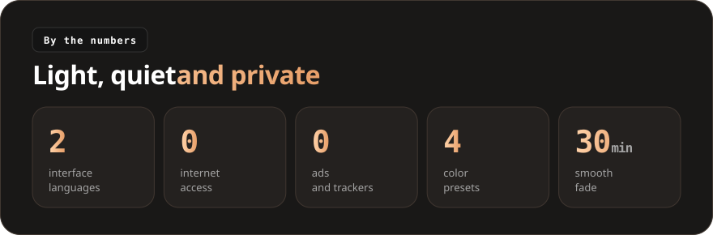

**English** · [العربية](README.ar.md) · [简体中文](README.zh-CN.md) · [繁體中文](README.zh-TW.md) · [Čeština](README.cs.md) · [Français](README.fr.md) · [Deutsch](README.de.md) · [Ελληνικά](README.el.md) · [Bahasa Indonesia](README.id.md) · [Gaeilge](README.ga.md) · [Italiano](README.it.md) · [日本語](README.ja.md) · [한국어](README.ko.md) · [Polski](README.pl.md) · [Română](README.ro.md) · [Русский](README.ru.md) · [Español](README.es.md) · [Українська](README.uk.md) · [اردو](README.ur.md) · [ئۇيغۇرچە](README.ug.md) · [Tiếng Việt](README.vi.md)

<div align="center">


<br>


<a href="https://github.com/sailxx/Ember/releases/latest/download/Ember.apk"></a>&nbsp;&nbsp;<a href="https://github.com/sailxx/Ember/releases/latest"></a>

**Ember is a blue light filter for Android.** In the evening the screen turns warm, in the morning it goes back to normal. Ember works out sunset and sunrise on its own, with no internet and no ads.

</div>

<br>


<details>
<summary><b>More about the features</b></summary>

### 🔥 Filter

A warm translucent layer covers the whole screen. **Strength** sets how dense it is, **dimming** makes the screen darker (handy at night instead of minimum brightness). The layer is drawn by an accessibility service: the system treats its window as trusted, so touches pass through the filter everywhere, even on protected screens. Ember never reads the screen. Without the service the filter falls back to “Display over other apps”, where Android 12+ limits opacity and blocks taps on some screens.

### 🌅 Schedule

Three modes: **By the sun** — tap “Locate” next to “Place”, Ember reads your coordinates once and calculates sunset and sunrise for every day (NOAA algorithm, right on the phone); **By time** — your own on and off times; **Always** — the filter stays on while enabled. Until a place is set, “By the sun” uses your own times (21:00–07:00 by default). The fade lasts 0, 15, 30 or 60 minutes. The chart on the main screen shows when and how strongly the filter warms the screen.

### 🎛 Tile and notification

The Ember tile in Quick Settings turns the filter on and off with one tap. The notification shows what’s happening (“2700 K · until 06:48” or “Waiting for sunset”) and has a “Turn off” button. After a reboot the filter comes back on its own.

### 🔒 Privacy

Ember has **no internet access** — the permission isn’t in the manifest. Coordinates are stored only in the app’s settings.

</details>

<br>


<br>



## About Ember


Ember started on **October 16, 2026** as a small project to make Android screens warmer at night. It's free and non-commercial. There are no ads, accounts, or analytics. Ember doesn't track you, doesn't collect your data, and never will.

Your settings stay on your phone. If you choose to use your location for the schedule, Ember reads it once and works out sunrise and sunset on the device. The app has no internet permission. [Privacy policy](PRIVACY.md)

## Roadmap


- [**0.1**](https://github.com/sailxx/Ember/releases/tag/v0.1) — The first version warmed the screen, followed sunset and sunrise, and showed the full day on a chart.
- [**0.2**](https://github.com/sailxx/Ember/releases/tag/v0.2) — The accessibility service let taps pass through the filter.
- [**0.3**](https://github.com/sailxx/Ember/releases/tag/v0.3) — Added custom on and off times and made it easier for Ember to find your location.
- [**0.4**](https://github.com/sailxx/Ember/releases/tag/v0.4) — Redesigned the daily chart and added clearer feedback when you tap a control.
- [**0.5**](https://github.com/sailxx/Ember/releases/tag/v0.5) — Switched from a debug key to Ember’s own key for signing releases.
- [**0.6**](https://github.com/sailxx/Ember/releases/tag/v0.6) — Added a temperature dial, a choice of light or dark theme, and tests for the daily schedule.
- [**0.7**](https://github.com/sailxx/Ember/releases/tag/v0.7) — Brought temperature and filter controls onto one screen, moved the schedule into a dialog, and added a floating switch.
- [**0.8**](https://github.com/sailxx/Ember/releases/tag/v0.8) — Made English the default with Russian in Settings, added the white-circle icon, and let the accessibility service apply the filter on its own.
- [**1.0**](https://github.com/sailxx/Ember/releases/tag/v1.0) — Simplified the temperature card and smoothed the slider. The card and filter button now change color together as you drag.

<details>
<summary><b>Install</b></summary>

1. Download [`Ember.apk`](https://github.com/sailxx/Ember/releases/latest/download/Ember.apk).
2. Open it on your phone and allow installing from unknown sources.
3. Open Ember, tap **Turn on filter**, then choose **Set up access → Accessibility** and enable Ember.
   On Android 13+ for apps installed outside Play, first open App info → ⋮ → “Allow restricted settings”.
4. Android 8.0 or newer.

</details>

<details>
<summary><b>Development</b></summary>

Kotlin 2.2 + Jetpack Compose (Material 3), no third-party dependencies.

```bash
./gradlew assembleRelease     # APK in app/build/outputs/apk/release/
./gradlew testDebugUnitTest   # sunset, sunrise and the filter curve
./gradlew lintDebug           # Android Lint checks
```

Requires JDK 17+ and Android SDK (platform 35). README images are generated — edit `tools/readme/strings.json` and run `cd tools/readme && npm install && node build.mjs`.

Before releasing, check these steps on a device in Always mode:

1. Tap the Quick Settings tile with both overlay permissions off. Grant either one and return to Ember. The filter should appear without tapping the tile again.
2. Toggle the filter from Quick Settings, then turn it off from the notification. Ember and the tile should agree. Changing the strength should leave the filter off.
3. Reboot with the filter enabled. After unlocking, the filter should return. Repeat with the accessibility service and with the display-over-other-apps permission separately.

</details>
