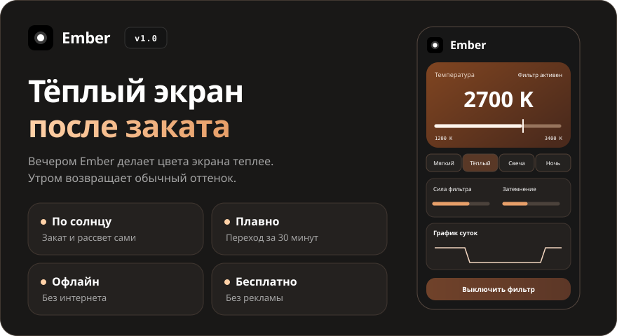
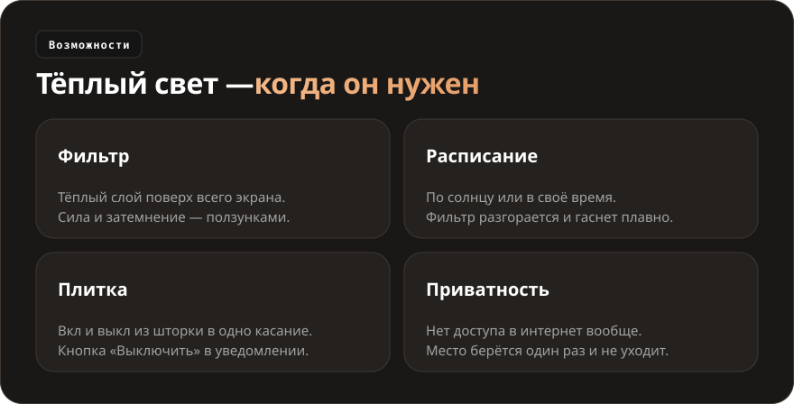
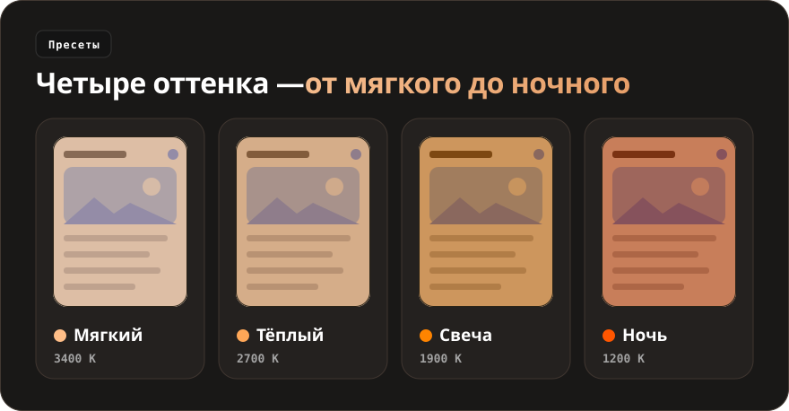
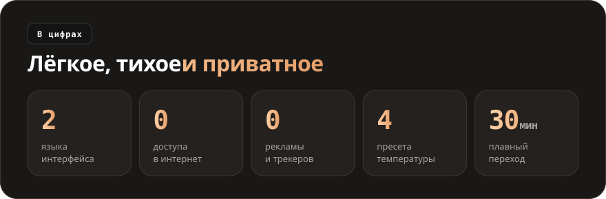

<div align="center">

**Русский** · [English](README.md)

<br>



<a href="https://github.com/sailxx/Ember/releases/latest/download/Ember.apk"></a>&nbsp;&nbsp;<a href="https://github.com/sailxx/Ember/releases/latest"></a>

**Ember — фильтр синего света для Android.** Вечером экран становится тёплым, а утром — снова обычным. Ember сам считает закат и рассвет, работает без интернета и рекламы.

</div>

<br>



<details>
<summary><b>Подробнее о возможностях</b></summary>

### 🔥 Фильтр

Поверх всего экрана лежит тёплый полупрозрачный слой. **Сила** задаёт, насколько он плотный, **затемнение** — насколько темнее станет экран (удобно ночью вместо минимальной яркости). Слой рисует служба специальных возможностей: её окно система считает доверенным, поэтому касания проходят сквозь фильтр везде, даже на защищённых экранах. Экран Ember не читает. Без службы фильтр работает через «Поверх других окон», но тогда Android 12+ ограничивает плотность и на части экранов блокирует нажатия.

### 🌅 Расписание

Три режима: **По солнцу** — нажми «Определить» у строки «Место», Ember один раз возьмёт координаты и будет считать закат и рассвет на каждый день (алгоритм NOAA, прямо на телефоне); **По времени** — своё время включения и выключения; **Всегда** — фильтр горит, пока включён. Пока место не задано, режим «По солнцу» работает по своему времени (по умолчанию 21:00–07:00). Переход длится 0, 15, 30 или 60 минут. График на главном экране показывает, когда и насколько сильно греет фильтр.

### 🎛 Плитка и уведомление

Плитка Ember в шторке включает и выключает фильтр в одно касание. В уведомлении видно, что сейчас происходит («2700 K · до 06:48» или «Ждёт заката»), и есть кнопка «Выключить». После перезагрузки фильтр включается сам.

### 🔒 Приватность

У Ember **нет доступа в интернет** — в манифесте нет этого разрешения. Координаты хранятся только в настройках приложения.

</details>

<br>



<br>



## О проекте


Ember начался **16 октября 2026 года** как небольшой проект, чтобы экран телефона вечером был теплее. Это бесплатный некоммерческий проект. Здесь нет рекламы, аккаунтов и аналитики. Ember не следит за тобой, не собирает твои данные и никогда не будет их собирать.

Настройки остаются на телефоне. Если попросишь Ember определить место для расписания, приложение один раз прочитает координаты и рассчитает закат и рассвет прямо на устройстве. Доступа к интернету у Ember нет. [Политика конфиденциальности](PRIVACY.md)

## Дорожная карта


- Проверить, как фильтр ведёт себя после перезагрузки и на разных телефонах Android.
- Упростить настройку расписания и яснее показывать, когда включится фильтр.
- Улучшить читаемость с крупным шрифтом и управление через TalkBack.

<details>
<summary><b>Установка</b></summary>

1. Скачай [`Ember.apk`](https://github.com/sailxx/Ember/releases/latest/download/Ember.apk).
2. Открой файл на телефоне и разреши установку из неизвестных источников.
3. Открой Ember, нажми **Включить фильтр** и выбери **Настроить доступ → Спецвозможности**. Включи Ember в системных настройках.
   На Android 13+ для приложений не из Play Маркета сначала открой «О приложении» → ⋮ → «Разрешить ограниченные настройки».
4. Android 8.0 и новее.

</details>

<details>
<summary><b>Разработка</b></summary>

Kotlin 2.2 + Jetpack Compose (Material 3), без сторонних зависимостей.

```bash
./gradlew assembleRelease     # APK в app/build/outputs/apk/release/
./gradlew testDebugUnitTest   # закат, рассвет и кривая фильтра
./gradlew lintDebug           # проверки Android Lint
```

Нужны JDK 17+ и Android SDK (platform 35).

Перед выпуском проверь на устройстве в режиме «Всегда»:

1. Нажми плитку без разрешений. Выдай одно из разрешений и вернись в Ember. Фильтр должен появиться без повторного нажатия плитки.
2. Переключи фильтр плиткой и затем выключи его из уведомления. Экран Ember и плитка должны показывать одинаковое состояние. Изменение силы после выключения не должно включать фильтр.
3. Оставь фильтр включённым и перезагрузи устройство. После разблокировки фильтр должен восстановиться. Выполни проверку отдельно со службой спецвозможностей и с разрешением «Поверх других окон».

Картинки README генерируются (тексты — в `tools/readme/strings.json`), не правь SVG руками:

```bash
cd tools/readme && npm install && node build.mjs
```

```
app/src/main/java/com/sailxx/ember/
├── MainActivity.kt   — экран «График суток»
├── FilterService.kt  — оверлей поверх экрана, пересчёт раз в 30 секунд
├── Schedule.kt       — окно заката–рассвета, плавность, цвет из Кельвинов
├── Sun.kt            — восход и закат по координатам (NOAA)
├── EmberTile.kt      — плитка в шторке
├── BootReceiver.kt   — автозапуск после перезагрузки
└── Prefs.kt          — настройки
```

Шрифты Golos Text и JetBrains Mono в картинках README — SIL Open Font License 1.1.

</details>
