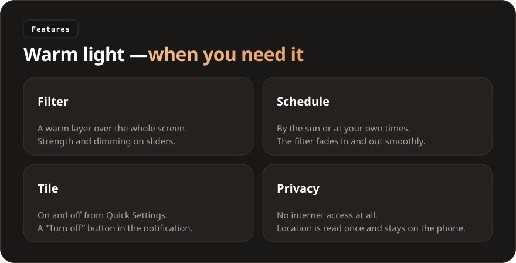

[English](README.md) · [العربية](README.ar.md) · [简体中文](README.zh-CN.md) · [繁體中文](README.zh-TW.md) · [Čeština](README.cs.md) · [Français](README.fr.md) · [Deutsch](README.de.md) · [Ελληνικά](README.el.md) · [Bahasa Indonesia](README.id.md) · [Gaeilge](README.ga.md) · [Italiano](README.it.md) · [日本語](README.ja.md) · [한국어](README.ko.md) · [Polski](README.pl.md) · [Română](README.ro.md) · [Русский](README.ru.md) · [Español](README.es.md) · **Українська** · [اردو](README.ur.md) · [ئۇيغۇرچە](README.ug.md) · [Tiếng Việt](README.vi.md)

<div align="center">


<br>


<a href="https://github.com/sailxx/Ember/releases/latest/download/Ember.apk"></a>&nbsp; &nbsp;<a href="https://github.com/sailxx/Ember/releases/latest"></a>

**Ember — це фільтр синього світла для Android.** Увечері екран стає теплим, вранці повертається до нормального стану. Ember самостійно розробляє захід і схід сонця, без Інтернету та реклами.

</div>

<br>



<details>
<summary><b>Детальніше про особливості</b></summary>

### 🔥 фільтр

Теплий напівпрозорий шар покриває весь екран. **Сила** встановлює його щільність, **затемнення** робить екран темнішим (зручно вночі замість мінімальної яскравості). Шар малюється службою доступності: система розглядає своє вікно як надійне, тому дотики проходять через фільтр скрізь, навіть на захищених екранах. Ember ніколи не читає екран. Без цієї служби фільтр повертається до «Відображати поверх інших програм», де Android 12+ обмежує прозорість і блокує натискання на деяких екранах.

### 🌅 розклад

Три режими: **За сонцем** — торкніться «Знайти» біля «Місце», Ember зчитує ваші координати один раз і обчислює захід і схід сонця для кожного дня (алгоритм NOAA, прямо на телефоні); **За часом** — власний час увімкнення та виходу; **Завжди** — фільтр залишається ввімкненим, поки ввімкнено. Поки не встановлено місце, «По сонцю» використовує ваш власний час (21:00–07:00 за замовчуванням). Згасання триває 0, 15, 30 або 60 хвилин. Діаграма на головному екрані показує, коли і наскільки сильно фільтр нагріває екран.

### 🎛 Плитка та сповіщення

Плитка Ember у швидких налаштуваннях вмикає та вимикає фільтр одним дотиком. Сповіщення показує, що відбувається («2700 K · до 06:48» або «Очікуємо на захід сонця») і має кнопку «Вимкнути». Після перезавантаження фільтр повертається самостійно.

### 🔒 Конфіденційність

Ember має **немає доступу до Інтернету** — дозволу немає в маніфесті. Координати зберігаються тільки в налаштуваннях програми.

</details>

<br>


<br>


## Про Ember


Ember почався на **16 жовтня 2026 р** як невеликий проект, щоб зробити екрани Android теплішими вночі. Це безкоштовно та некомерційно. Немає реклами, облікових записів чи аналітики. Ember не стежить за вами, не збирає ваші дані і ніколи не буде.

Ваші налаштування залишаються на телефоні. Якщо ви вирішите використовувати своє місцезнаходження для розкладу, Ember зчитує його один раз і розраховує схід і захід сонця на пристрої. Додаток не має доступу до Інтернету. [Політика конфіденційності](PRIVACY.md)

## Дорожня карта


- [**0.1**](https://github.com/sailxx/Ember/releases/tag/v0.1) — Перша версія нагрівала екран, відстежувала захід і схід сонця та показувала весь день на графіку.
- [**0.2**](https://github.com/sailxx/Ember/releases/tag/v0.2) — Служба доступності пропускає крани через фільтр.
- [**0.3**](https://github.com/sailxx/Ember/releases/tag/v0.3) — Додано спеціальний час увімкнення та вимкнення та полегшено для Ember визначення вашого місцезнаходження.
- [**0.4**](https://github.com/sailxx/Ember/releases/tag/v0.4) — Перероблено щоденний графік і додано чіткіші відгуки, коли ви торкаєтеся елемента керування.
- [**0.5**](https://github.com/sailxx/Ember/releases/tag/v0.5) — Змінено з ключа налагодження на власний ключ Ember для підписання випусків.
- [**0.6**](https://github.com/sailxx/Ember/releases/tag/v0.6) — Додано циферблат температури, вибір світлої або темної теми та тести для щоденного розкладу.
- [**0.7**](https://github.com/sailxx/Ember/releases/tag/v0.7) — Перенесено елементи керування температурою та фільтром на один екран, перенесено розклад у діалогове вікно та додано плаваючий перемикач.
- [**0.8**](https://github.com/sailxx/Ember/releases/tag/v0.8) — Зробив англійську за замовчуванням із російською в налаштуваннях, додав значок із білим колом і дозволив службі спеціальних можливостей застосовувати фільтр самостійно.
- [**1.0**](https://github.com/sailxx/Ember/releases/tag/v1.0) — Спростили температурну картку та згладили повзунок. Картка та кнопка фільтра тепер разом змінюють колір під час перетягування.

<details>
<summary><b>встановити</b></summary>

1. Завантажити [`Ember.apk`](https://github.com/sailxx/Ember/releases/latest/download/Ember.apk).
2. Відкрийте його на телефоні та дозвольте встановлення з невідомих джерел.
3. Відкрийте Ember, торкніться **Увімкніть фільтр**, тоді вибирайте **Налаштувати доступ → Спеціальні можливості** і ввімкніть Ember.
   На Android 13+ для додатків, встановлених за межами Play, спочатку відкрийте інформацію про додаток → ⋮ → «Дозволити обмежені налаштування».
4. Android 8.0 або новіше.

</details>

<details>
<summary><b>розвиток</b></summary>

Kotlin 2.2 + Jetpack Compose (Матеріал 3), відсутність сторонніх залежностей.

```bash
./gradlew assembleRelease     # APK in app/build/outputs/apk/release/
./gradlew testDebugUnitTest   # sunset, sunrise and the filter curve
./gradlew lintDebug           # Android Lint checks
```

Потрібні JDK 17+ і Android SDK (платформа 35). Зображення README генеруються — редагувати `tools/readme/strings.json` і бігти `cd tools/readme && npm install && node build.mjs`.

Перш ніж відпустити, перевірте ці кроки на пристрої в режимі "Завжди".:

1. Торкніться плитки швидких налаштувань, вимкнувши обидва дозволи на накладання. Надайте будь-який із них і поверніться до Ember. Фільтр має з’явитися без повторного торкання плитки.
2. Увімкніть фільтр у швидких налаштуваннях, а потім вимкніть його в сповіщенні. Ember і плитка повинні погодитися. Змінюючи інтенсивність, слід залишити фільтр вимкненим.
3. Перезавантажте з увімкненим фільтром. Після розблокування фільтр повинен повернутися. Повторіть окремо для служби доступності та дозволу відображення поверх інших програм.

</details>
